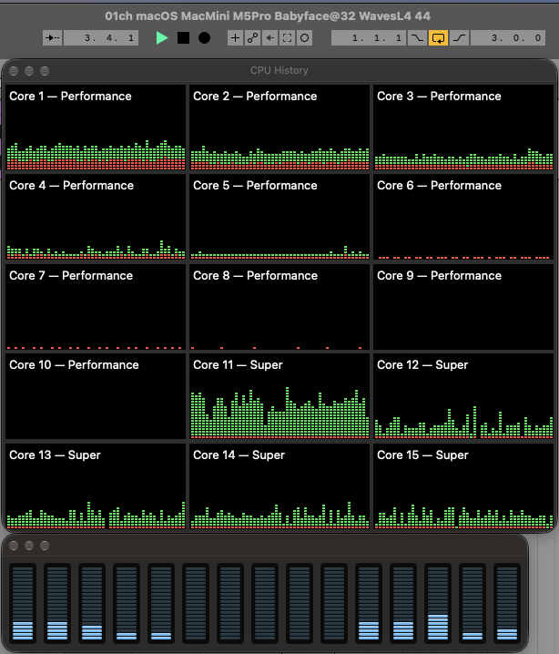
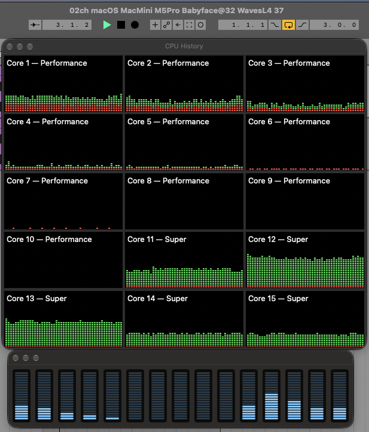
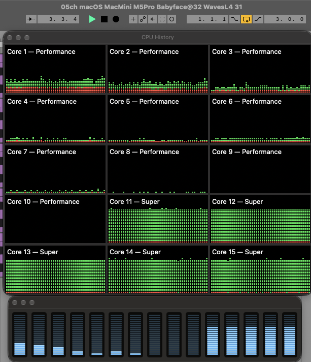
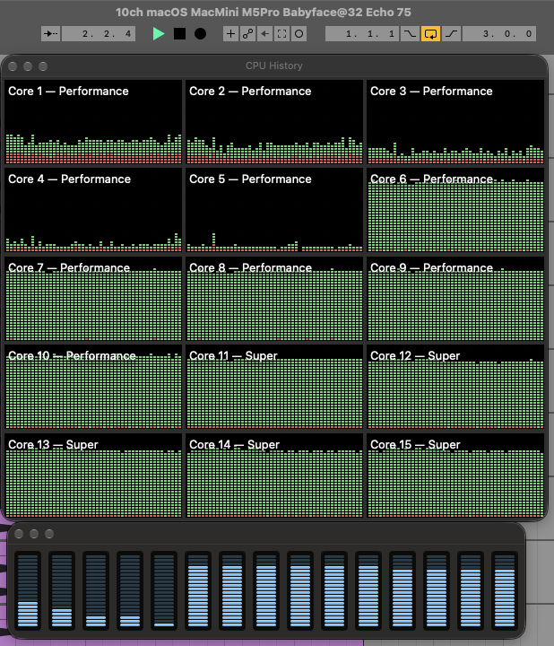
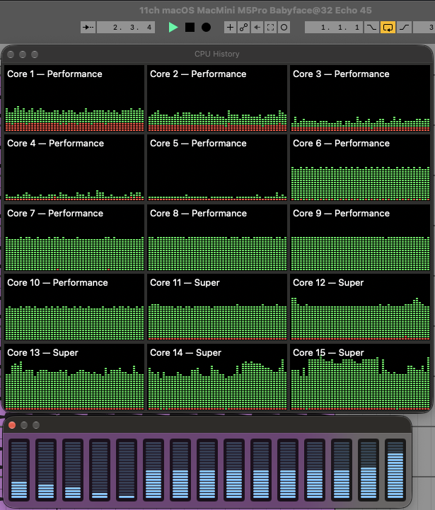
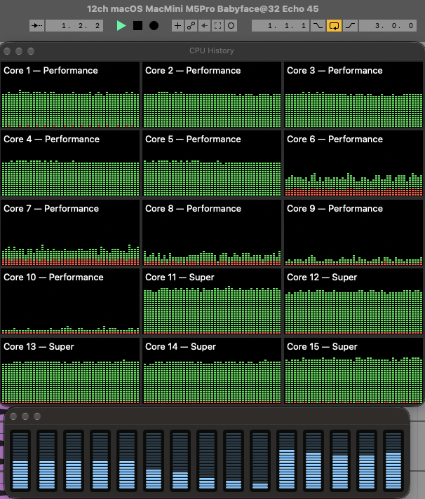
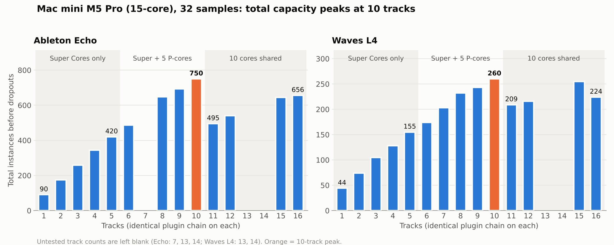
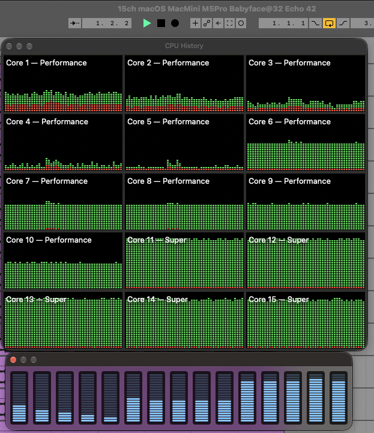
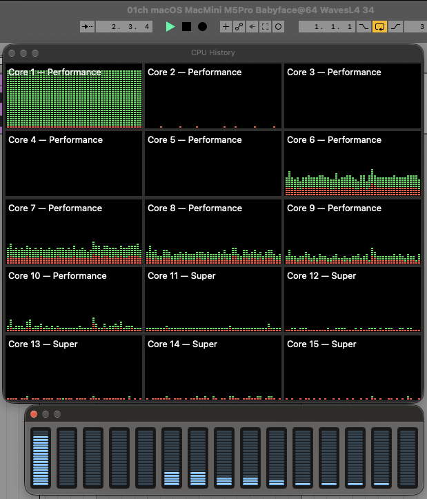
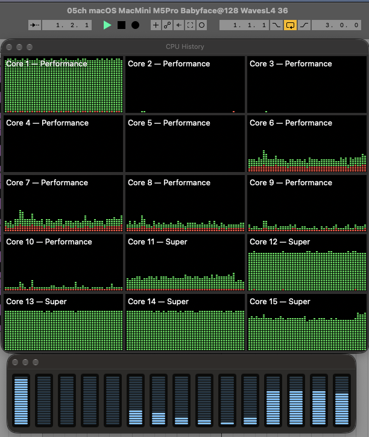

# Ableton Live 12
# Beyond P-Cores, Part 2: The Mac mini M5 Pro and Its 10-Core Audio Ceiling

*Originally published on [Gearspace](https://gearspace.com/threads/beyond-p-cores-part-2-the-mac-mini-m5-pro-and-its-10-core-audio-ceiling.1470264/), October 2026.*

*A follow-up to [Beyond P-Cores: How Apple's 3-Tier Silicon (M5/M6) Impacts Low-Latency DSP Buffer Scaling and Core Allocation](https://camplaix.github.io/beyond-p-cores-apple-m6-ableton-live-12/). Same Live project, same plugins, same method.*

In Part 1, the base M6's problem was scarcity. With only **2 Super Cores**, a second heavy track in Ableton Live 12 already spilled onto the slower mid-tier P-cores, and the slowest core set the limit for the whole session.

The 15-core M5 Pro looked like the fix. It has **5 Super Cores and 10 P-cores**, and no Efficiency cores at all. Five heavy tracks should fit on the top tier, and there are ten more fast cores behind them.

Some of that held up. Up to five tracks, everything stays on the Super Cores, and the early spillover from Part 1 is gone. But the M5 Pro also showed three things I didn't expect:

1. **Waves L4 loses almost 30% per track from 1 to 5 tracks while staying entirely on the Super Cores.** That changes how I read part of the M6 results.
2. **Only 10 of the 15 cores ever carry audio.** Five P-cores sit out at every track count I tested. Total capacity peaks at 10 tracks and falls when you add an 11th.
3. **Buffer inversion isn't limited to a single track.** At 128 samples, one track in a five-track Waves L4 session gets moved onto a P-core, and that track sets the limit for all five.

## Test Rig

- **Apple Silicon:** Mac mini M5 Pro (15-core: 5 Super, 10 Performance, no Efficiency cores; 24 GB Unified Memory) running macOS Golden Gate.
- **DAW:** Ableton Live 12, same version (12.4.6) and the same project as Part 1.
- **Audio Interface:** RME Babyface Pro FS (USB 2.0 @ 44.1 kHz / 32 samples), latest RME DriverKit driver.
- **Plugins:** Waves L4 Ultramaximizer (third-party) and Ableton Echo (native).
- **Method:** Unchanged. Every track carries an identical plugin chain, and instances are raised or removed on all tracks equally until the dropouts stop. The recorded value is the highest per-track count without dropouts.

The Mac mini M6 and Intel Core Ultra 7 270K Plus results are from Part 1, which has their full setup details.

*A note on reading the captures: Activity Monitor numbers the M5 Pro's cores the other way round from the M6. On the M5 Pro, **Cores 1–10 are P-cores and Cores 11–15 are Super Cores**. In every capture, the load splits into three groups of five: Cores 1–5, Cores 6–10 and Cores 11–15. As in Part 1, each bar averages about a second, so a core sitting right at its dropout limit won't show 100%. Two captures were saved just before I raised the count to its final limit, so their window titles show one to four instances fewer than the results in the text (9 tracks of Echo: 73 vs. 77; 15 tracks of Echo: 42 vs. 43).*

## 1 to 5 Tracks: Five Super Cores, No Spill

A single track sustains **44 Waves L4** and **90 Echo** instances at 32 samples. That's 15.4% and 11.8% below the Mac mini M6's 52 and 102. Per core, the M5 Pro's Super Cores are a clear step behind the M6's. They even trail the MacBook Pro base M5 from Part 1, whose fast cores are the same top tier: 96 Echo instances on one track against 90 here. That was a different machine on macOS Tahoe, so I wouldn't read too much into it. On Echo, a single track lands level with the Intel 270K Plus over PCIe (89).

\
*1 track, 32 samples, Waves L4: the load runs mostly on Super Core 11, with some time on Cores 12–15. The P-cores carry only background activity.*

Unlike the M6, adding tracks doesn't push anything onto the P-cores. At two tracks of Waves L4, where the M6 had already spilled, both tracks stay on the Super Cores:

\
*2 tracks, 32 samples, Waves L4 (37 per track): the load spreads across Super Cores 11–15, mostly 12 and 13. P-cores 6–10 are idle and Cores 1–5 carry only background activity.*

It's the same at five tracks, with all five Super Cores loaded and P-cores 1–10 still out of it:

\
*5 tracks, 32 samples, Waves L4: Super Cores 11–15 run near their limit, and the P-cores carry only background activity.*

I have captures at 1, 2 and 5 tracks for Waves L4 and at 1 and 5 for Echo. The 3- and 4-track sessions fall between them, and their numbers fit the same pattern. The two plugins scale very differently, though:

| Tracks | Echo / track | % of 1 track | Waves L4 / track | % of 1 track |
|:---:|:---:|:---:|:---:|:---:|
| 1 | 90 | 100% | 44 | 100% |
| 2 | 87 | 97% | 37 | 84% |
| 3 | 86 | 96% | 35 | 80% |
| 4 | 86 | 96% | 32 | 73% |
| 5 | 84 | 93% | 31 | 70% |

Echo loses 6.7% from 1 to 5 tracks. That's almost the same as the MacBook Pro base M5 in Part 1 (−6% from 1 to 4 tracks), whose four fast cores are the same top tier. It's also enough for the M5 Pro to edge out the M6 on Echo from 3 to 5 tracks (420 vs. 415 total at 5), despite the M6's faster individual Super Cores.

Waves L4 loses **29.5%**, and **16%** of that is gone by the second track, with no P-core involved.

I can't say from these tests what causes it. A general drop in clock speed as more cores get busy doesn't fit well, because Echo runs on the same five Super Cores and barely loses anything. Whatever it is, it's specific to the plugin. My guess is that L4 is more sensitive to resources the Super Cores share, such as cache and memory bandwidth, but I haven't measured that.

### What this means for Part 1

In Part 1 I put the M6's drop from one to two Waves L4 tracks down to the second track landing on a P-core, and called the 2-track figure "the P-core ceiling." The M5 Pro shows almost the same drop at two tracks (44 → 37 per track) with both tracks on Super Cores. So at least part of the M6's 2-track L4 drop probably comes from the same effect rather than from the P-core tier, and Part 1's "~73% of a Super Core" figure likely overstates the gap between tiers.

The P-cores are still slower; the single-track buffer inversion below shows that on both chips. But the gap between the tiers is smaller than Part 1 suggests, and some of what I measured there is a different effect.

## 6 to 10 Tracks: The P-Cores Join

From the sixth track on, the load has to spill onto the P-cores, since there are only five Super Cores. I don't have captures at 6, 7 or 8 tracks, but the numbers show it: the per-track limit drops a little at six tracks and then holds steady.

- **Echo:** 84 → **81** per track at 6 tracks, still 81 at 8, then 77 at 9 and 75 at 10.
- **Waves L4:** 31 → **29** per track at 6 tracks, still 29 at 7 and 8, then 27 at 9 and 26 at 10.

The step from 5 tracks (Super Cores only) to 6 (first P-core) costs only 3.6% on Echo and 6.5% on L4. On a chip with every fast core already busy, the gap between a Super Core and a P-core turns out to be small. The M6 is a different story at this track count: with six fast cores (2 Super + 4 P) for six tracks, it runs 35 L4 instances per track against the M5 Pro's 29, a 20.7% lead (210 vs. 174 total).

The 9-track captures show the P-group filling up one core at a time: Cores 6–9 carry audio alongside the five Super Cores, while Core 10 is still idle. At 10 tracks the session reaches its highest total: **750 Echo** and **260 Waves L4** instances. That's 47% and 24% above the M6's best totals with one track per fast core (510 and 210).

\
*10 tracks, 32 samples, Ableton Echo: Cores 6–15 (five P-cores and all five Super Cores) form a solid wall. Cores 1–5 carry only background activity.*

## The 10-Core Ceiling

The capture above is the best case the M5 Pro reached: ten tracks on ten cores. The obvious next step would be five more tracks for the five idle P-cores. That isn't what happens.

In every capture from 9 to 16 tracks, **no more than 10 cores carry audio at once**: the five Super Cores plus one group of five P-cores. The other five P-cores only show background activity, even at 15 and 16 tracks.

\
*11 tracks, 32 samples, Ableton Echo: still only Cores 6–15 carry audio. Cores 1–5 stay at background level, even though one of the ten active cores now has to run two tracks.*

Which P-group sits out isn't fixed. In most captures it's Cores 1–5. In three of them (12 tracks of Echo, and 15 and 16 tracks of Waves L4), the roles swap: Cores 1–5 take the audio and Cores 6–10 drop to background level.

\
*12 tracks, 32 samples, Ableton Echo: this time P-cores 1–5 carry the audio together with Super Cores 11–15, and P-cores 6–10 sit at background level.*

The two groups also perform the same. Echo tops out at 45 per track both at 11 tracks, with audio on Cores 6–10, and at 12 tracks, with audio on Cores 1–5. So neither group is slower or reserved by its hardware, and the limit looks like a number of cores rather than specific cores. It isn't only a 32-sample effect either: at 128 samples, the 11th track still causes the same drop (74 → 47 Echo instances per track), so a looser deadline doesn't bring the idle P-cores in, at least up to 128 samples. I don't know where it comes from. Some possibilities:

- **macOS scheduler policy.** With no Efficiency cores, macOS may keep one P-cluster free for system and background work.
- **CoreAudio's `os_workgroup`** limiting how many threads join the real-time workgroup.
- **Live's own thread pool** sizing its audio workers to 10 on this machine.

One useful next check would be counting Live's audio threads during playback. If there are only 10, the limit is in Live or in how Live sizes its pool. If there are more and they share 10 cores, it's on the macOS side.

## Two Cliffs: Track 11 and Track 16

\
*Total instances on the Mac mini M5 Pro at 32 samples: capacity rises to 10 tracks, drops at 11, and never gets back above the 10-track peak.*

**Track 11.** With only 10 cores in use, an 11th track means one core has to run two tracks. Because every track carries the same plugin chain, that core sets the limit for the whole session:

- **Echo:** 75 → **45** per track (−40%), total 750 → 495. It's the same at 128 samples: 74 per track at 10 tracks, 47 at 11.
- **Waves L4:** 26 → **19** per track (−27%), total 260 → 209.

**Tracks 12 to 15.** As more cores take a second track, the totals climb back: 540 Echo and 216 L4 at 12 tracks, 645 and 255 at 15. At 15 tracks, five cores run two tracks each and five run one. The Echo capture suggests the Super Cores are the ones running two:

\
*15 tracks, 32 samples, Ableton Echo: Super Cores 11–15 run near their limit, while P-cores 6–10 sit at roughly 60%. Cores 1–5 carry only background activity.*

Echo at 15 tracks is still 14% below the 10-track peak. Waves L4 comes much closer, 255 against 260. One instance per track is worth 15 instances in total at 15 tracks, so that's effectively a tie.

**Track 16.** At 16 tracks, six cores have to run two tracks. There are only five Super Cores, so at least one P-core must now be running two. Waves L4 drops again, from 17 to **14** per track: 224 in total, 12% below 15 tracks. Echo only goes from 43 to **41** per track, and its total actually rises a little, from 645 to 656. That fits Echo's much smaller gap between Super Cores and P-cores.

The captures can't show which core carries two tracks, but the numbers fit this reading. A core running two tracks should manage about half of what it manages with one:

| Session | Per track | × 2 | One track per core on the same tier |
|---|:---:|:---:|---|
| 11 tracks, Echo | 45 | 90 | 90 (Super Core, 1 track) |
| 11 tracks, Waves L4 | 19 | 38 | 37 (Super Core, 2 tracks) |
| 16 tracks, Echo | 41 | 82 | 81 (P-core plateau, 6–8 tracks) |
| 16 tracks, Waves L4 | 14 | 28 | 29 (P-core plateau, 6–8 tracks) |

To be fair to the M5 Pro, every system has a cliff like this as soon as there are more equally heavy tracks than cores carrying audio. On the Intel 270K Plus over PCIe, Echo goes from 87 per track at 8 tracks to 43 at 16. The M5 Pro's problem is that its cliff arrives at 11 tracks instead of 16, because a third of the chip doesn't take part.

### Summary: Four Scaling Regimes

| Regime | Tracks | Cores carrying audio | Echo / track (total) | Waves L4 / track (total) |
|---|:---:|---|:---:|:---:|
| **1. Super Cores only** | 1 | 1 Super Core | 90 (90) | 44 (44) |
| | 2 | Super Cores 11–15 | 87 (174) | 37 (74) |
| | 3 | *(no capture)* | 86 (258) | 35 (105) |
| | 4 | *(no capture)* | 86 (344) | 32 (128) |
| | 5 | All 5 Super Cores | 84 (420) | 31 (155) |
| **2. P-cores join** | 6 | *(no capture)* 5 Super + 1 P | 81 (486) | 29 (174) |
| | 7 | *(no capture)* 5 Super + 2 P | n/t | 29 (203) |
| | 8 | *(no capture)* 5 Super + 3 P | 81 (648) | 29 (232) |
| | 9 | 5 Super + 4 P (Core 10 idle) | 77 (693) | 27 (243) |
| | 10 | 5 Super + 5 P | **75 (750)** | **26 (260)** |
| **3. 10 cores shared** | 11 | 10 cores, 5 P idle | 45 (495) | 19 (209) |
| | 12 | 10 cores, 5 P idle | 45 (540) | 18 (216) |
| | 15 | 10 cores, 5 P idle | 43 (645) | 17 (255) |
| **4. A P-core runs two tracks** | 16 | 10 cores, 5 P idle | 41 (656) | 14 (224) |

*All at 32 samples. n/t = not tested. The 6–8 track rows are inferred from the numbers, not from captures.*

## Buffer Inversion, Again — and Now With Five Tracks

The single-track buffer inversion from Part 1 reproduces on the M5 Pro. At 32 samples, one track of Waves L4 runs on the Super Cores. At 64 samples, the thread moves onto a single P-core, Core 1, and the Super Cores go quiet:

\
*1 track, 64 samples, Waves L4: the whole load sits on P-core 1, while Super Cores 11–15 are almost idle.*

Headroom drops from 44 to **34 instances at 64 samples (−22.7%)**. It only partly recovers at larger buffers: 36 at 128 and 37 at 256, still 16% below the 32-sample result. Echo again avoids the demotion and gains normally, from 90 to 93, 97 and 99 at 64, 128 and 256 samples (+10%).

On the M6 I could only see this with a single track, because multi-track sessions were already on the P-cores. With five Super Cores, the M5 Pro shows it with several tracks too:

\
*5 tracks, 128 samples, Waves L4: one track has moved to P-core 1, leaving Super Core 11 mostly idle. The other four stay on Super Cores 12–15.*

At 32 samples, the same five tracks all ran on Super Cores 11–15. At 128 samples, one of them moves to P-core 1. The session limit comes out at **36 per track**, exactly the single-track L4 result at 128 samples.

A bigger buffer still helps overall: 31 per track at 32 samples, 33 at 64 and 36 at 128 (+16%). But the gain stops at the ceiling of whichever track has been demoted. Echo shows no such cap at 5 tracks (84 → 88 → 90).

At 10 tracks, a bigger buffer didn't help Echo at all: 75 per track at 32 samples, 74 at 128. I don't have a capture of that session, so I can't say whether a track was demoted there too.

## Three Machines Side by Side

*As in Part 1: the Macs use the Babyface (USB) at 32 samples. "Babyface @ 48" is the same-interface Intel result at the Windows driver's minimum buffer, and "PCIe @ 32" is the internal RME HDSPe AIO Pro at a matching buffer. n/t = not tested.*

### Waves L4

| | Mac mini M6 | Mac mini M5 Pro (15-core) | Intel Core Ultra 7 270K Plus |
|---|---|---|---|
| **Cores carrying audio** | 6 (2 Super + 4 P) | **10 of 15** (5 Super + 5 P) | 8 P-cores |
| **Single track** | **52** | 44 | 36 (Babyface @ 48) |
| **2 tracks** | 74 (37/track) | 74 (37/track) | n/t |
| **6 tracks** | **210** (35/track) | 174 (29/track) | n/t |
| **One track per audio core** | 210 (6 × 35) | 260 (10 × 26) | **288** (8 × 36, PCIe @ 32) 240 (8 × 30, Babyface @ 48) |
| **12 tracks** | 204 (17/track) | 216 (18/track) | n/t |
| **16 tracks** | n/t | 224 (14/track) | n/t |

### Ableton Echo

| | Mac mini M6 | Mac mini M5 Pro (15-core) | Intel Core Ultra 7 270K Plus |
|---|---|---|---|
| **Single track** | **102** | 90 | 89 (PCIe @ 32) 82 (Babyface @ 48) |
| **5 tracks** | 415 (83/track) | **420** (84/track) | n/t |
| **One track per audio core** | 510 (6 × 85) | **750** (10 × 75) | 696 (8 × 87, PCIe @ 32) 640 (8 × 80, Babyface @ 48) |
| **12 tracks** | 504 (42/track) | 540 (45/track) | n/t |
| **16 tracks** | n/t | 656 (41/track) | **688** (43/track, PCIe @ 32) 656 (41/track, Babyface @ 48) |

The M5 Pro has the highest Echo total of the three: 750 at 10 tracks, 7.8% above the Intel on PCIe. On Waves L4 it lands between the two: ahead of the M6 and the Babyface-limited Intel, but 9.7% behind the Intel on PCIe. That's despite having 15 cores against Intel's 8.

Per core carrying audio, it's the lowest of the three (75 Echo and 26 L4 at the peak, against 85 and 35 on the M6 and 87 and 36 on Intel over PCIe). Most of that comes from the effect described in the 1–5 track section, which grows as more cores get busy. And once the session goes past 10 tracks, the advantage is gone: at 12 tracks, the M5 Pro leads the 12-core M6 by only 6–7%, and at 16 tracks its 656 Echo instances tie the Intel on the Babyface and trail it on PCIe.

## What This Means in Practice

The caveats from Part 1 apply here too. Stacking dozens of limiters on identical tracks at 32 samples is a stress test built to expose limits, not a normal session. Most real projects have a few heavy tracks and a lot of light ones, and an M5 Pro handles them with plenty of room to spare.

With that in mind:

- **The M5 Pro fixes the M6's early spillover.** Up to five heavy real-time chains all get a Super Core, which matters most for low-latency tracking with heavy vocal strips, amp sims or synths.
- **The single-track ceiling is an optimistic number.** Some plugins, Waves L4 here, lose a lot of headroom as more cores get busy, even on the top tier. A chain that runs fine alone may need more room once the rest of the session is playing.
- **Past 10 equally heavy tracks, the 15-core M5 Pro hits a cliff.** Five of its fifteen cores aren't used for audio in these tests. In a typical uneven session you're unlikely to notice. In a session with many equally demanding real-time chains, you may well hit it.
- **A bigger buffer still helps with several tracks, but not always as much as it should.** Third-party plugins can still get one track demoted to a P-core, and that track then sets the limit for the session.

## Open Questions

- **Where does the 10-core ceiling come from?** macOS, CoreAudio's workgroups and Live's thread pool are all candidates.
- **Does the 18-core M5 Pro or the M5 Max behave the same way?** If the ceiling is "Super Cores plus one P-cluster," the bigger chips would hit it at a different track count. I haven't tested them.
- **Why is Waves L4 so much more sensitive to busy cores than Echo?** Possibly how much cache or memory bandwidth it needs, but I haven't measured that.

As in Part 1, everything here is Ableton Live only, for the reasons given there: Live runs every track in real time within each audio callback, which makes it a direct probe of per-core real-time performance.

[← Part 1: Beyond P-Cores (Apple M6)](https://camplaix.github.io/beyond-p-cores-apple-m6-ableton-live-12/) · [← Back to camplaix.github.io](https://camplaix.github.io/)
